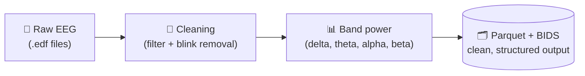
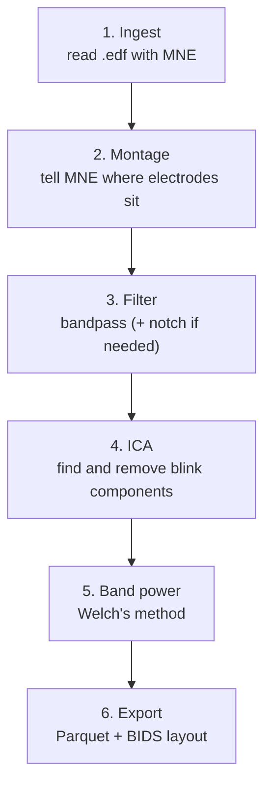

# 🧠 EEG-CLEAN-PIPELINE

### Config-driven electroencephalogram-EEG cleaning and band-power pipeline: raw PhysioNet `.edf` in, clean Parquet out

> **Status: work in progress.** Built step by step in public. Sections marked **(planned)** are not implemented yet and will be filled in as the project grows.

---

## 📚 Table of Contents

1. [What This Project Does](#-1-what-this-project-does)
2. [Why a Pipeline, Not a Notebook](#-2-why-a-pipeline-not-a-notebook)
3. [The Concepts (plain English)](#-3-the-concepts-plain-english)
4. [The Pipeline](#-4-the-pipeline)
5. [Setup](#%EF%B8%8F-5-setup)
6. [Project Structure (planned)](#-6-project-structure-planned)
7. [Output Schema (planned)](#-7-output-schema-planned)
8. [How to Run (planned)](#%EF%B8%8F-8-how-to-run-planned)
9. [Results (planned)](#-9-results-planned)
10. [Roadmap](#%EF%B8%8F-10-roadmap)
11. [Glossary](#-11-glossary)
12. [License](#-12-license)

---

## 🎯 1. What This Project Does

Raw EEG recordings are messy: eye blinks, muscle noise, slow drift and electrical hum all leak into the signal. This project takes those raw recordings and turns them into **clean, structured brainwave metrics** that anyone can analyse.



- **Input:** [PhysioNet EEG Motor Movement/Imagery](https://physionet.org/content/eegmmidb/1.0.0/) (109 subjects, 64 channels)
- **Output:** one Parquet row per subject, channel and frequency band

---

## 🔧 2. Why a Pipeline, Not a Notebook

Most EEG examples are one-off notebooks. This project is built like production data engineering:

| Principle | What it means here |
|---|---|
| **Config-driven** | Filter settings live in a config file, never hardcoded |
| **Tested** | Tests for filter correctness and output schema *(planned)* |
| **Logged** | Clear logs and error handling for malformed files *(planned)* |
| **Schema-stable** | The Parquet columns stay the same on every run |
| **Reproducible** | A stranger clones the repo, runs one command, gets the same output |

---

## 🧠 3. The Concepts (plain English)

| Concept | Plain meaning |
|---|---|
| **EEG** | Sensors on the scalp record the brain's tiny electrical signals as lines that go up and down over time |
| **Channel** | One electrode. A 64-channel recording has 64 signals at once |
| **Sampling rate** | How many readings per second each channel records |
| **Artifact** | Anything in the recording that is not brain activity: eye blinks, jaw clenches, cable movement |
| **Bandpass filter** | Keeps only the frequencies between two limits and drops the rest |
| **ICA** | Splits the recording into independent sources, so the "blink" source can be found and removed |
| **Band power** | How much of the signal sits in each frequency band (delta, theta, alpha, beta) |
| **Welch's method** | The standard, less noisy way to measure power per frequency |
| **Parquet** | A compact, fast column-based file format for tables |
| **BIDS** | A standard folder layout for neuroscience datasets |

---

## 🔄 4. The Pipeline



Frequency bands used:

| Band | Range (Hz) |
|---|---|
| Delta | 0.5 – 4 |
| Theta | 4 – 8 |
| Alpha | 8 – 12 |
| Beta | 13 – 30 |

---

## 🛠️ 5. Setup

You need **Python 3.11**. Use a fresh virtual environment so this project's libraries stay separate from everything else.

```bash
git clone https://github.com/Rahu002/eeg-clean-pipeline.git
cd eeg-clean-pipeline

python3.11 -m venv neuro
source neuro/bin/activate        # Windows: neuro\Scripts\activate

pip install mne numpy scipy matplotlib pandas scikit-learn jupyterlab
pip install mne-bids pyarrow
```

| Package | What it does |
|---|---|
| `mne` | Reads EEG files, cleans them, slices them |
| `numpy`, `scipy` | Math and filters |
| `pandas`, `pyarrow` | Tables and Parquet output |
| `mne-bids` | Saves data in the BIDS folder format |
| `matplotlib` | Plots (before/after, spectra) |

> A GPU is not needed. EEG files are small.

---

## 📁 6. Project Structure (planned)

```text
eeg-clean-pipeline/
├── src/eeg_clean_pipeline/   ← pipeline code
├── configs/                  ← filter and band settings
├── tests/                    ← filter and schema tests
├── data/                     ← raw EEG files (git-ignored)
├── README.md
└── LICENSE
```

---

## 🗂️ 7. Output Schema (planned)

One row per subject, recording run, channel and band:

| Column | Meaning |
|---|---|
| `subject` | Subject ID |
| `run` | Recording run number (each subject has several runs) |
| `channel` | Electrode name |
| `band` | delta / theta / alpha / beta |
| `relative_power` | Share of total power that sits in this band |
| `absolute_power` | Power in this band |

---

## ▶️ 8. How to Run (planned)

```bash
python -m eeg_clean_pipeline --config configs/default.yaml
```

---

## 📈 9. Results (planned)

- Before/after plot showing blinks removed by ICA
- Sample of the output Parquet table
- Findings and notes

---

## 🗺️ 10. Roadmap

- [x] Repository created (public, MIT)
- [ ] Load one subject and inspect channels and sampling rate
- [ ] Set montage
- [ ] Bandpass filter (and notch if the data needs it)
- [ ] ICA blink removal + before/after plot
- [ ] Relative band power (Welch)
- [ ] Parquet export with a locked schema
- [ ] BIDS layout
- [ ] Config file for all filter settings
- [ ] Logging and error handling
- [ ] Tests (filter correctness, output schema)
- [ ] Scale from one subject to all 109

---

## 📖 11. Glossary

| Term | One-line definition |
|---|---|
| **Epoch** | A labelled time slice of the recording |
| **Event / trigger** | A timestamped marker saying "something happened here" |
| **PSD** | Power spectral density: how much power at each frequency |
| **Montage** | Where each electrode physically sits on the head |
| **10-20 system** | The standard naming grid for electrode positions |
| **EOG / EMG** | Eye-movement signal / muscle signal (both are artifacts here) |
| **Nyquist** | You can only see frequencies below half the sampling rate |
| **Notch filter** | Removes one specific frequency, such as mains hum |

---

## 📄 12. License

MIT. See [LICENSE](LICENSE).

---

<p align="center">
  Part of the <b>WEAPON: NEURO</b> series. If this helps you, consider giving the repo a ⭐
</p>
